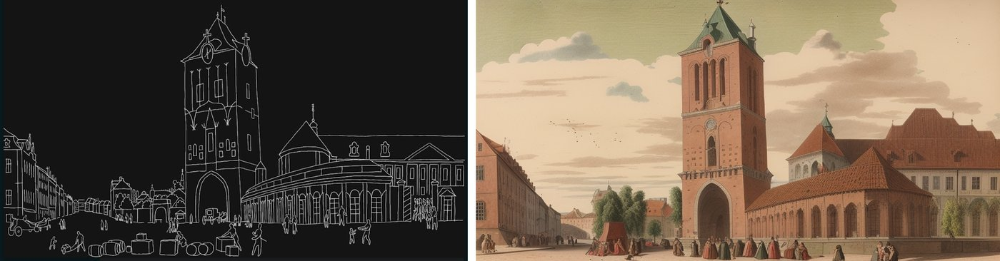
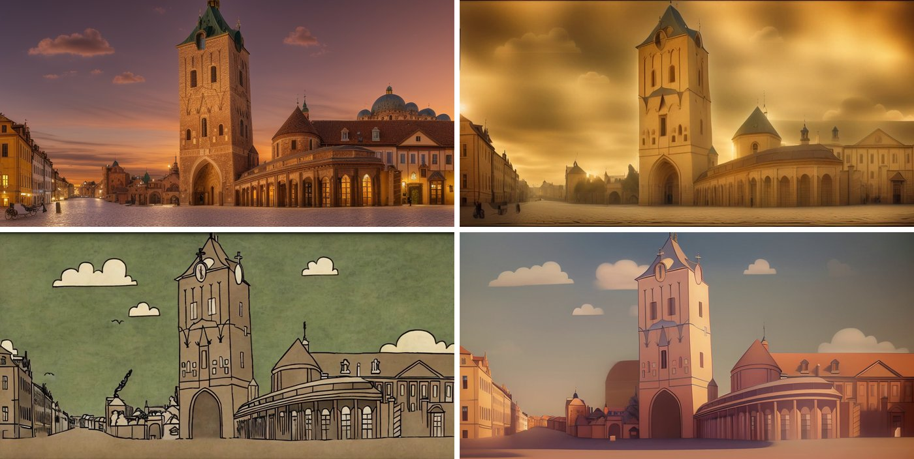
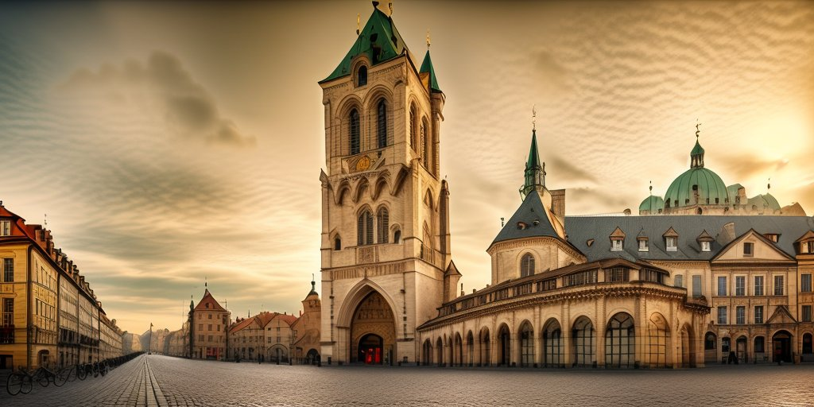
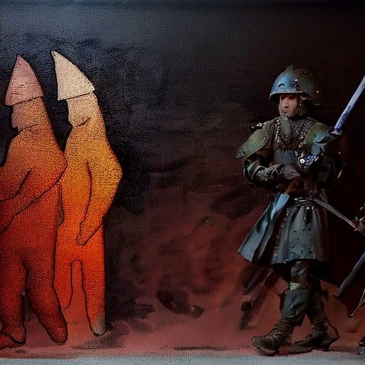
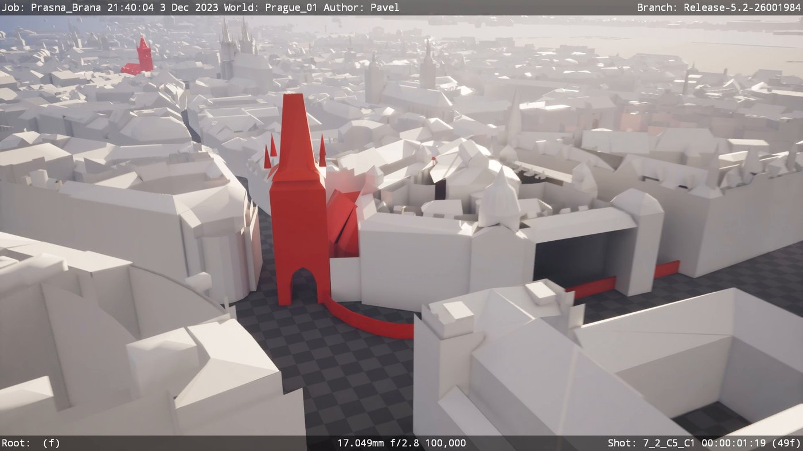

## What is this?
A prototype for a history exhibition on Prague's Old Town Square. The idea: visitors look out at the real square, and the view travels back in time to show what stood there before and what happened on that spot.

The prototype told one story, the story of the Royal Court (Králův dvůr). It covers about 600 years at the corner where the Powder Tower and the Municipal House stand today: the medieval town walls and gate, the royal residence of Wenceslaus IV, the coronation processions setting out on the Royal Way, the rebuilding of the Powder Tower, and the opening of the Municipal House, where Czechoslovakia was proclaimed in 1918.

## My role
I was part of a small multidisciplinary team that brought together history research, scriptwriting, illustration and 3D. My part was the technology question: can generative AI be used for this at all? So I designed and ran the AI workflows in ComfyUI and worked out the camera moves for the scenes.

## The challenge
The concept deck asked the questions directly: is it usable, what can you do with it, what can the visuals look like, and can AI be used? Historical visuals are hard for generative AI. A model will happily paint "an old town square", but the buildings have to be the right ones, in the right place, from a fixed viewpoint. They also have to stay stable from frame to frame, because the scenes are animated, not stills.

## How I built it
The trick was not to let the AI invent the layout. Every scene starts from a line drawing of the real view, and the AI only adds the style, materials and light on top of that structure.

*Line drawing of the real view (left) turned into a painted historical scene by the ComfyUI workflow (right)*

The ComfyUI workflow:

- **ControlNet (canny)** locks the composition to the line drawing, so the tower and the buildings stay where they really are.
- **IP-Adapter** takes a reference image and transfers its look, so one scene can come out painted, golden-hour, or illustrated just by swapping the reference.
- **AnimateDiff** turns the stills into short animated shots, including camera motion such as a slow zoom in.
- **RIFE frame interpolation** smooths the motion into fluid video.
- It runs on Stable Diffusion 1.5 with a photoreal checkpoint, and it can process whole image sequences, so animated line art goes in and an animated scene comes out.

*Same view, different looks: testing which visual style suits the exhibition*

*A golden-hour take on the same corner, styled through IP-Adapter*

I also tested animated characters, such as soldiers and a medieval knight, generated from line-art animation sequences.

*Character test: animated figures generated from line-art sequences*

To plan the shots, I blocked the cameras in Unreal Engine on a 3D model of Prague, with the key buildings highlighted. The moves include flights from the exhibition viewpoint to the Powder Tower and through the gate.

*Camera previs in Unreal Engine: the historical buildings highlighted in red on a 3D model of the city*

## Result
The prototype showed that generative AI can produce historical scenes that stay true to the real place, as long as the structure comes from real drawings and the AI only does the look. The team got a working pipeline and a range of visual styles to choose from. On top of that, the camera previs and the scene-by-scene script moved the story of the Royal Court from an idea to something you can actually watch.
