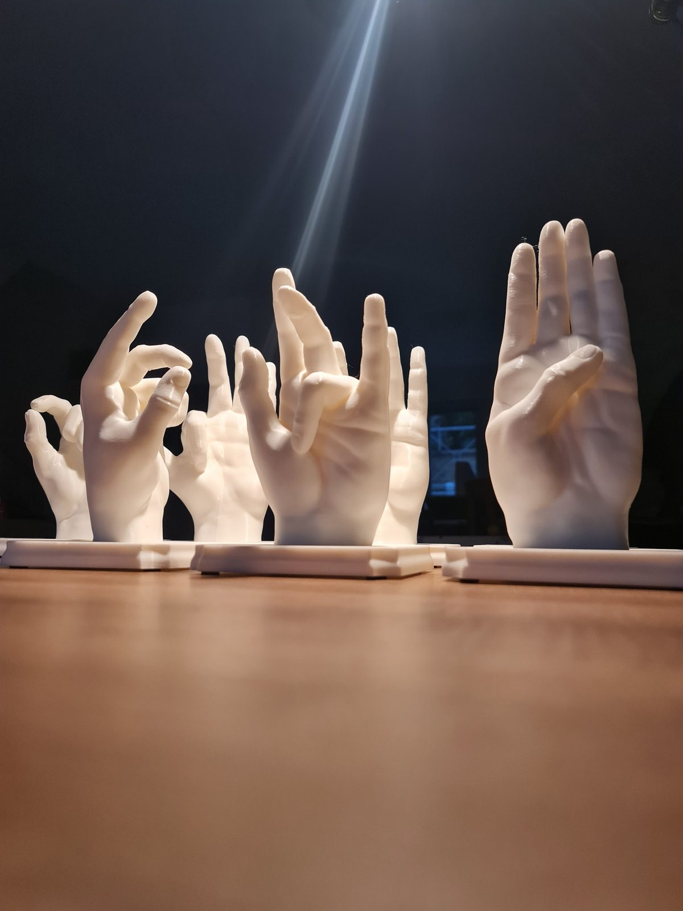

## What is this?
A set of white 3D-printed hands, each one showing a different gesture, made for [Prof. Pavel Kolář's research project on proprioception](https://www.cpmpk.cz/co-je-propriocepce-a-proc-ji-profesor-kolar-oznacuje-za-sesty-smysl) at the Centrum pohybové medicíny Pavla Koláře in Prague. Proprioception is the body's sense of the movement, tension and position of its own joints and muscles, and Prof. Kolář calls it our "sixth sense". It's what lets us keep our balance and coordinate movement, even with our eyes closed.

## My part
The hands themselves were already modelled. My job was the part they stand on: I designed and modelled the base mechanism.

  

    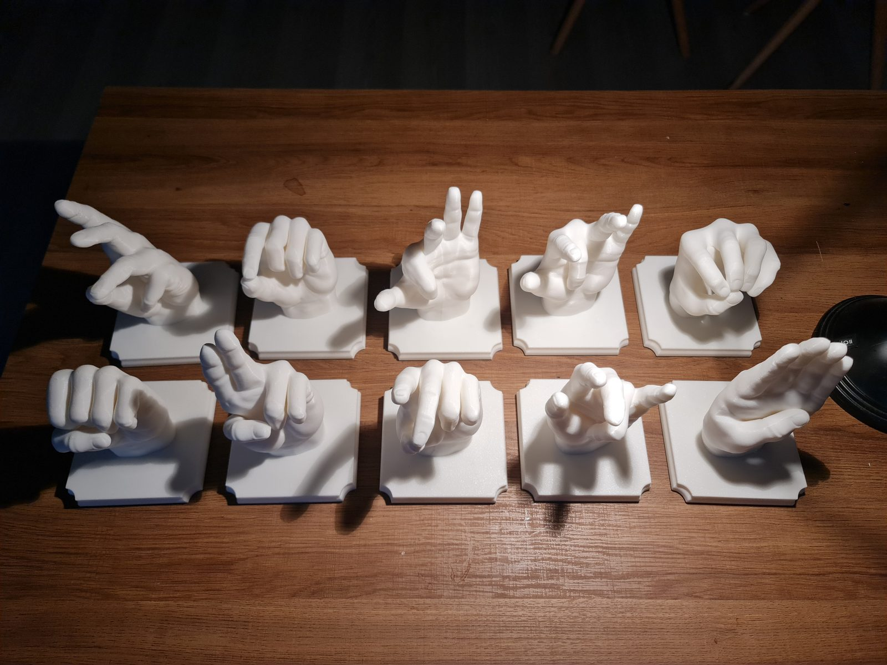
    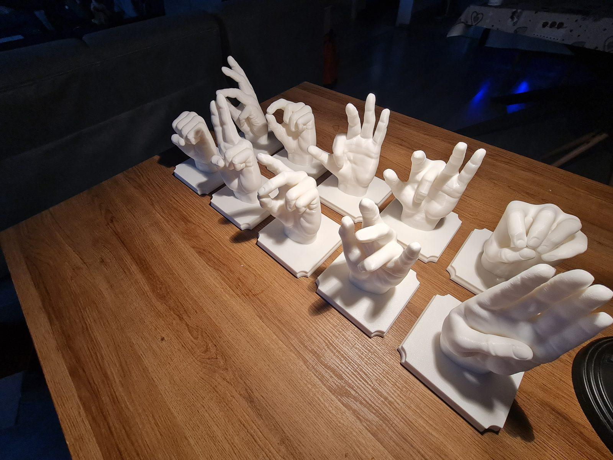
    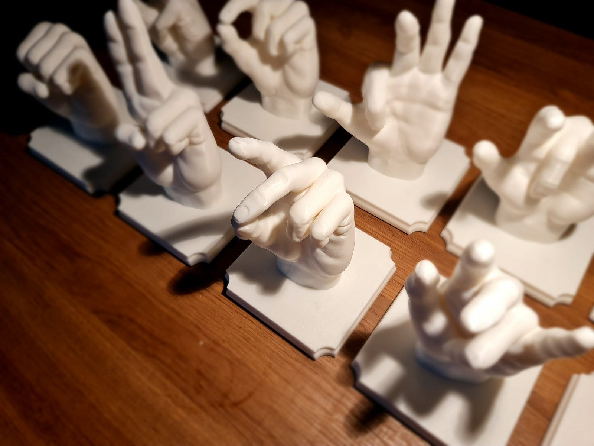
    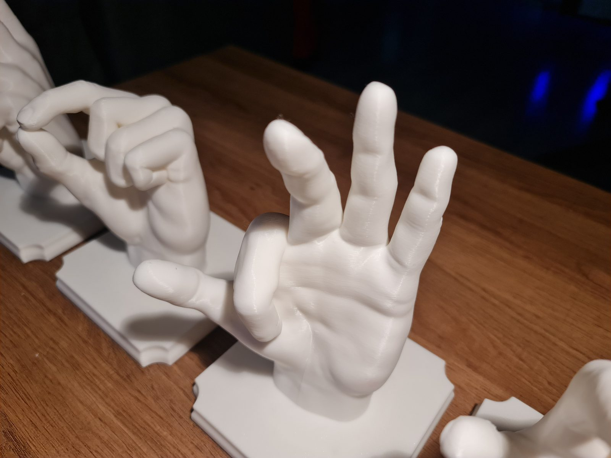
  

  <em>The finished set of 10 hands.</em>

## How I approached it
The base looks simple, but it had to do a few practical jobs at once:

- **Weight.** The base gives each piece some weight.
- **RFID.** The base holds an RFID tag, so every hand can be identified.
- **Printable at scale.** The design is easy to 3D print in larger quantities.
- **Rough and easy to reprint.** The pieces are made to be robust, and if one is ever needed again, it can simply be reprinted.

## How it's built
Each piece is a handful of parts: the printed hand, a base with four rubber feet and a ring in the centre, a cover plate, an octagonal peg, a large steel washer and a few screws.

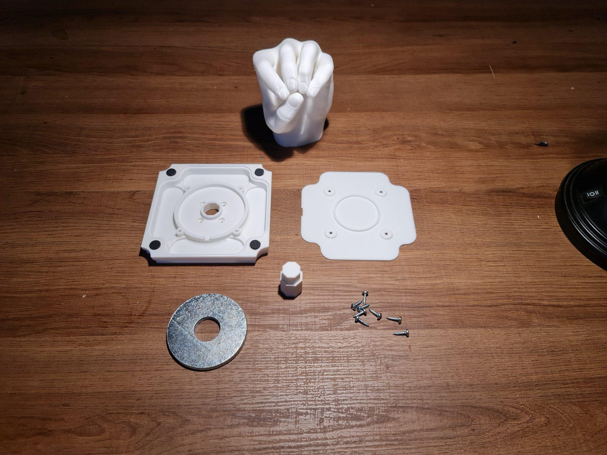
*All the parts of one piece*

The steel washer sits in the centre of the base and gives the piece its weight. The cover plate and screws close it up.

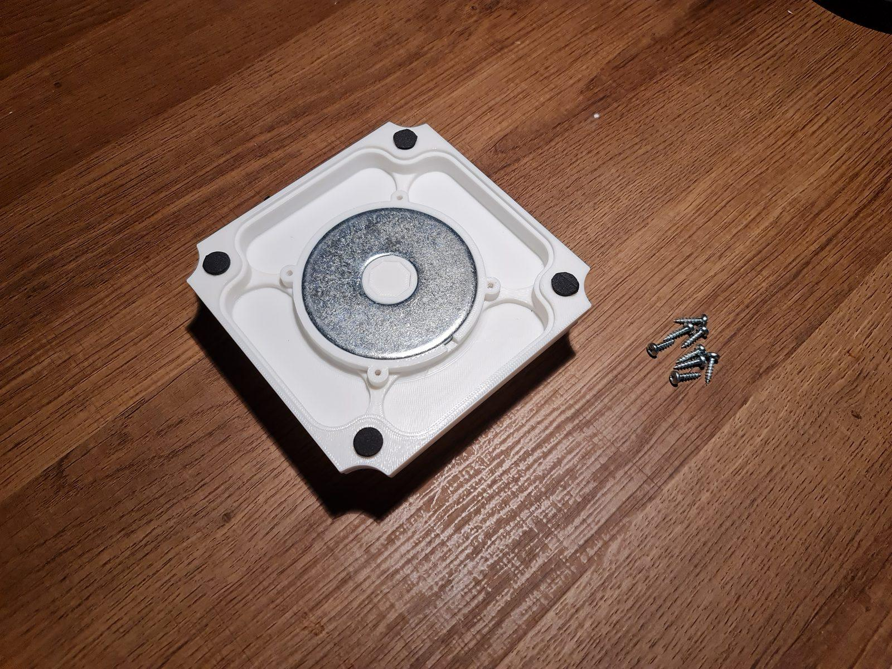
*The steel washer seated in the base*

The octagonal peg sits in the wrist of the hand and keys it into the base.

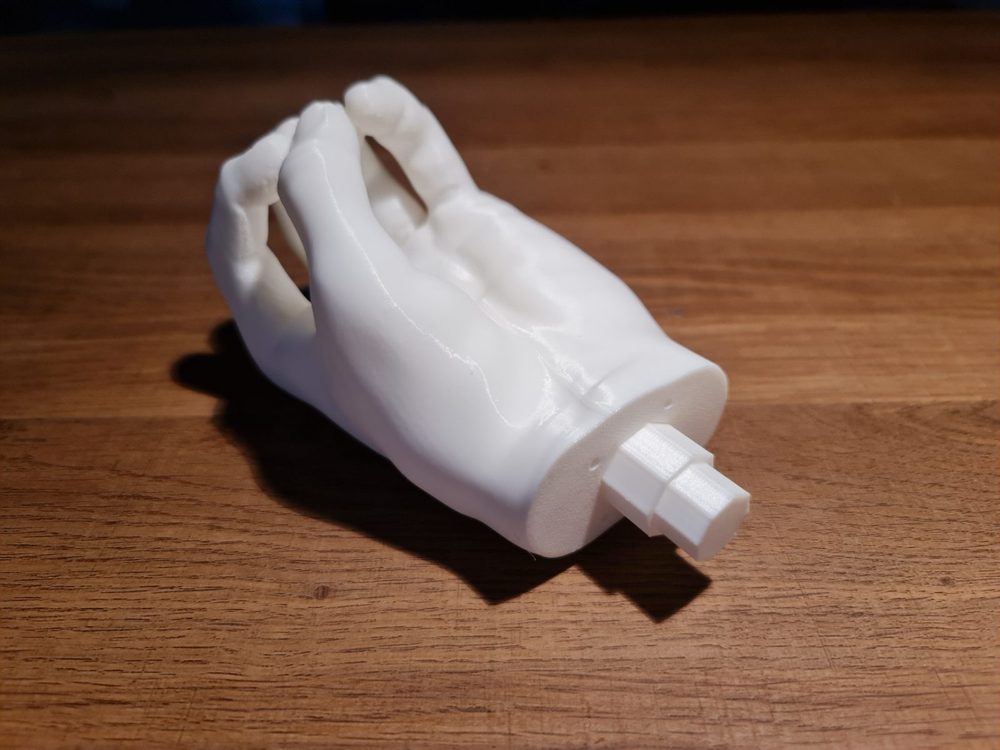
*The peg in the wrist of the hand*

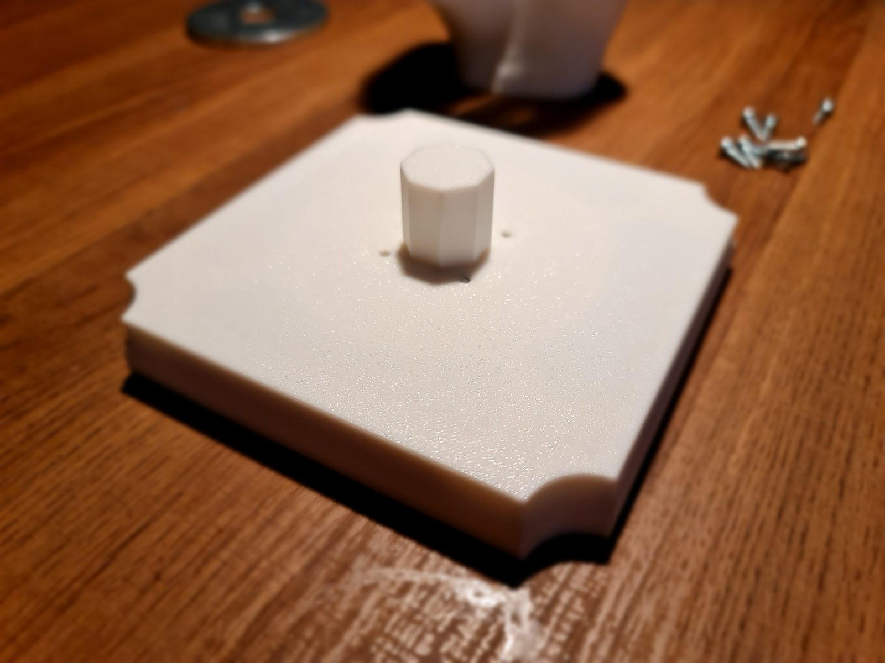
*The assembled base, ready for its hand*

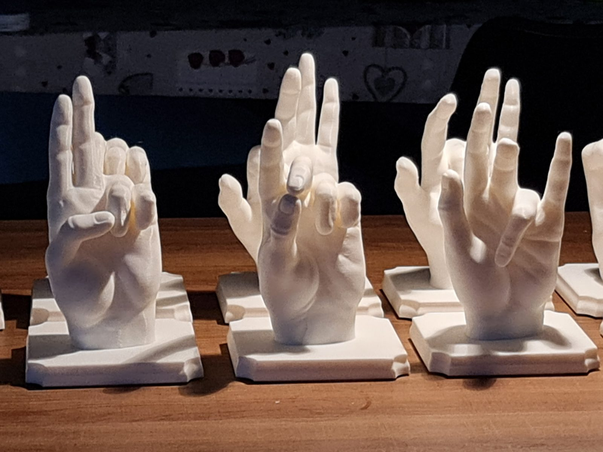
*Different gestures, same base*

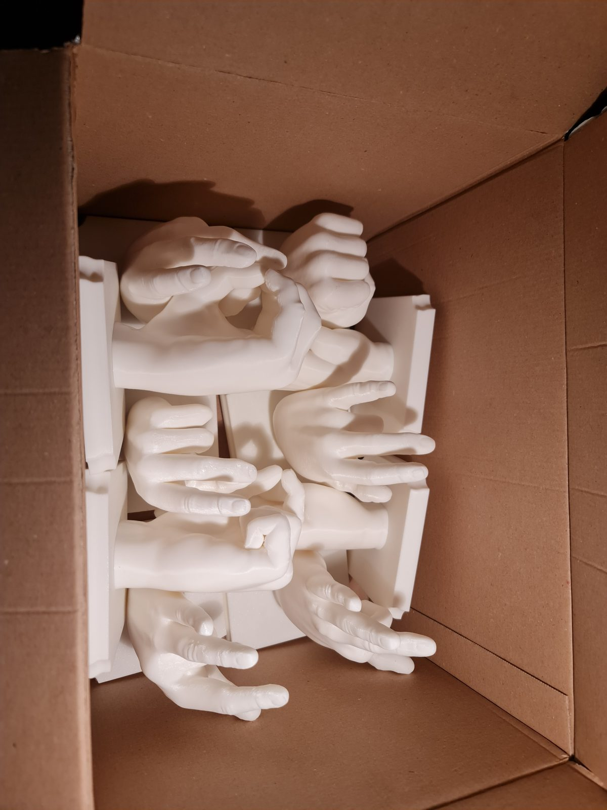
*Packed up, ready to go*

## Result
A set of 10 hands on matching bases, practical to produce and easy to keep going, because any piece is just one more print away.
