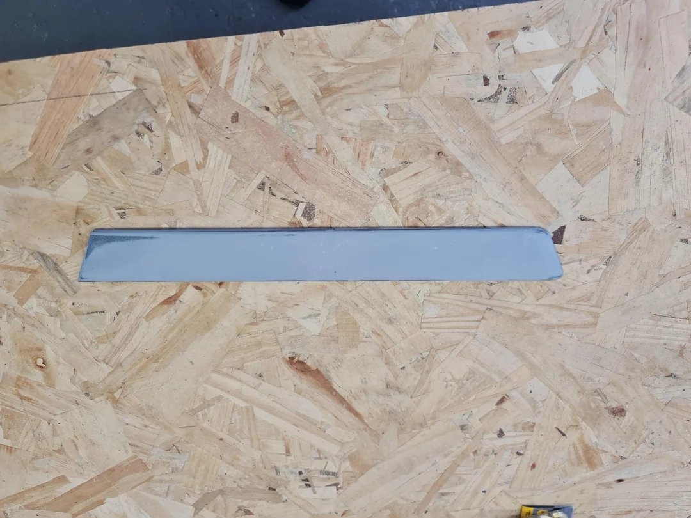
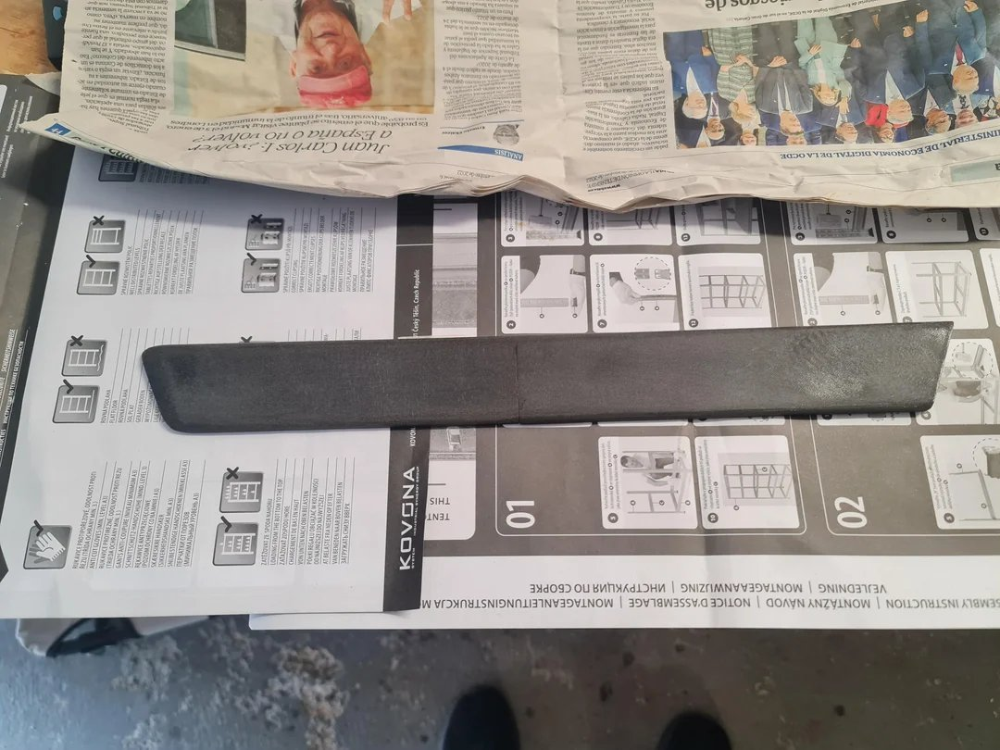
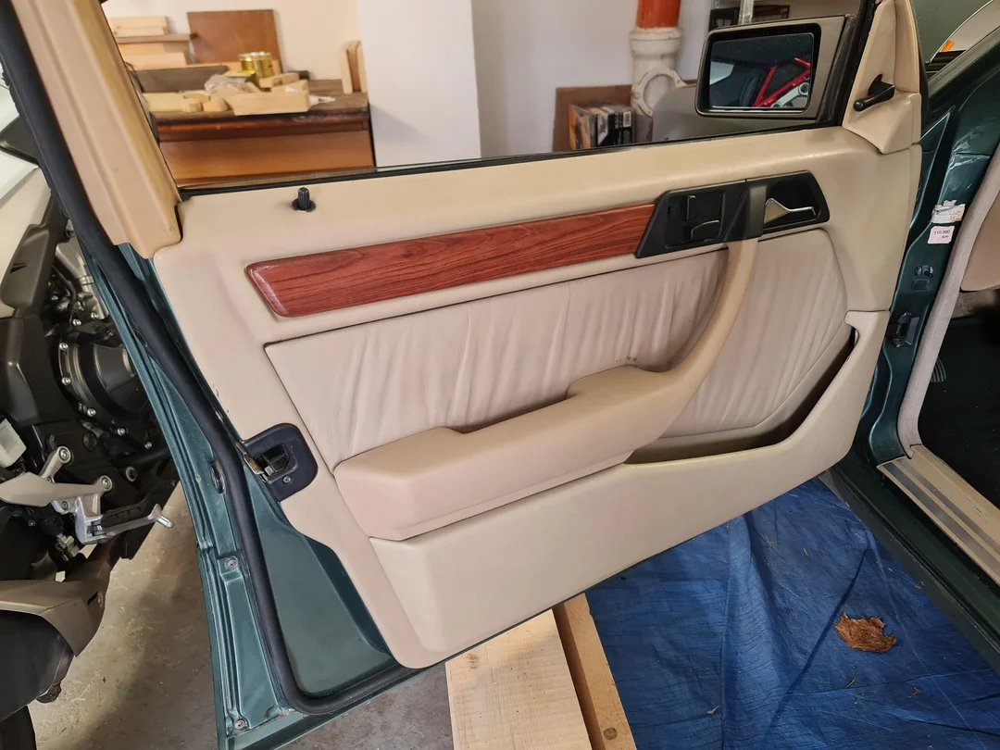
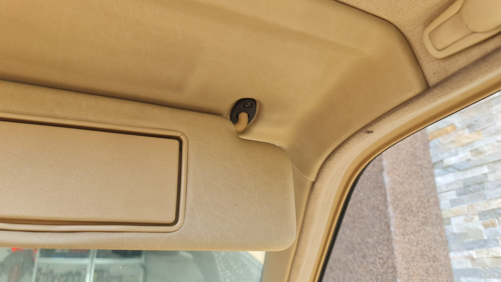
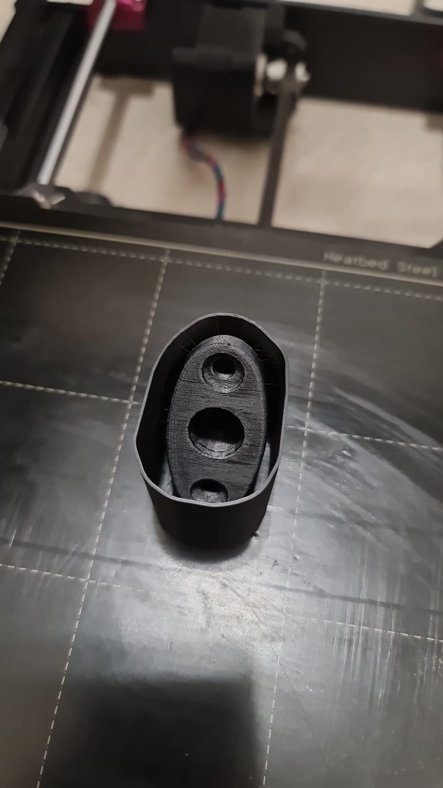
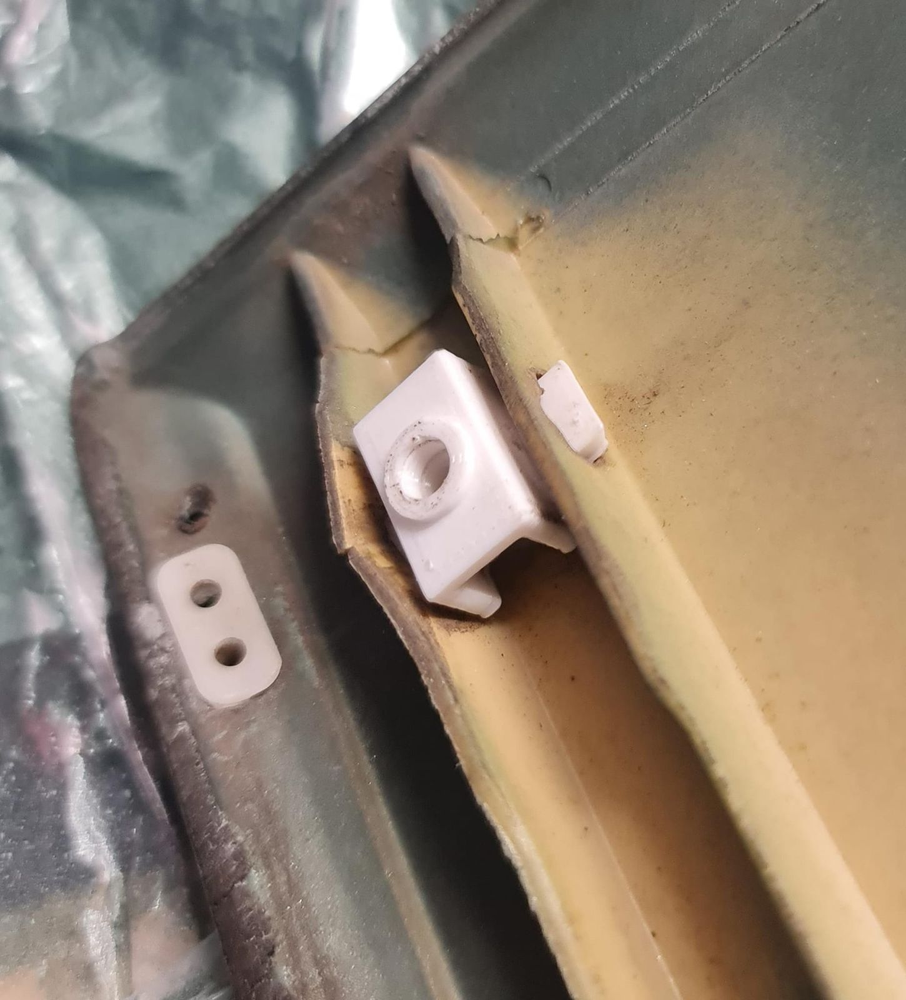

[SEE ALL MY MODELS ON PRINTABLES](https://www.printables.com/@Pavelios_4547983)

## What is this?
I drive a Mercedes-Benz W124, and parts for a car this old are either hard to find or gone for good. So when something was missing or broken, I designed a replacement, printed it and fitted it to the car. Then I published the models on Printables for free, so other W124 owners can print their own.

## How I approach it
Automotive parts are a different game from desk prints. A car cabin gets very hot in summer, and some of these parts take real force every day, so the design has to be right or the part simply breaks. That's why the design starts with how the part will be used and how it can fail:

- **Heat-resistant material.** Cabin heat softens PLA, so I print automotive parts in ASA, which withstands high temperatures and UV.
- **Designed to be tough.** Layer lines are the weak spot of a print, so print orientation is part of the design: forces must not run along them, and walls and joints are sized for the load.
- **Designing around the printer.** A part that is too long for a normal print bed gets split, with a joint designed to hold.
- **Honest notes.** Each model page says what worked, what didn't and what I would do differently.

## Selected models

### Sacco front door wood trim (sedan)
The wood trim on my door panel was completely gone, so I made a replacement. The trim is too long for a standard print bed, so it's split into two parts. The interlocking joint was the hardest part to design: the trim is slim, it has to survive the cabin expanding and contracting it with temperature, and the two halves should hold together mostly by friction, so a gap doesn't open up.

*The printed trim, before finishing*

After printing I sanded it, filled the joint with plastic filler, sanded it smooth again and applied a wood grain vinyl with a heat gun, to match the original Sacco trim.

*Filled and sanded, ready for the vinyl*

*Fitted on the door*

It has been in my car for 2 years and holds up. The one thing I'd change: I printed it in PETG, which is hard to glue, so you can feel the seam with a finger. The model page recommends ASA glued with acetone instead.

[View the model on Printables](https://www.printables.com/model/1800599-mercedes-benz-w124-sacco-front-door-wood-trim-seda)

### Sun visor holder bracket
A small part that takes a lot of abuse: the sun visor rotates in it every time it's used. I rotated the model by 60 degrees by design, because when it's printed flat, the layer lines end up exactly where all the forces are and the holder snaps.

*The bracket in the car, holding the sun visor*

*Fresh off the print bed*

[View the model on Printables](https://www.printables.com/model/1800637-mercedes-benz-w124-sacco-trim-sun-visor-holder-bra)

### Sacco trim mount kit: the missing upper pin
An existing community mount kit for the W124 Sacco panels (by ptashek) was missing one mount: the upper pin on the rear doors. I designed the missing piece so the kit is complete. It prints in PETG without supports.

*The missing pin, fitted in the door panel*

[View the model on Printables](https://www.printables.com/model/1655381-mercedes-w124-sacco-trim-mount-kit-missing-upper-p)

## Result
Missing parts back in the car, designed from the problem up, and shared so others with the same car don't have to start from zero. You can find all my models on my [Printables profile](https://www.printables.com/@Pavelios_4547983).
