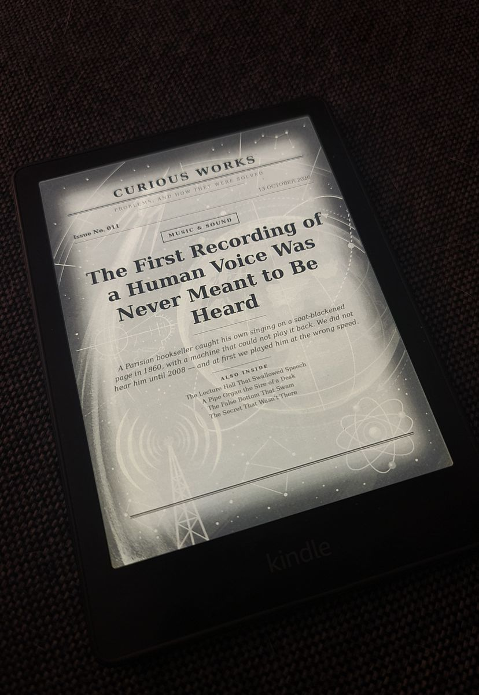
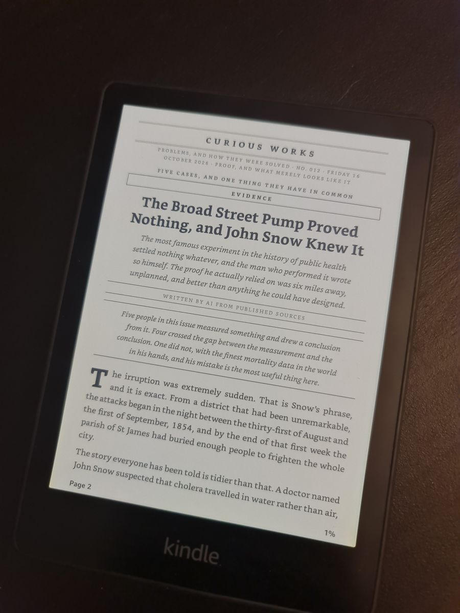
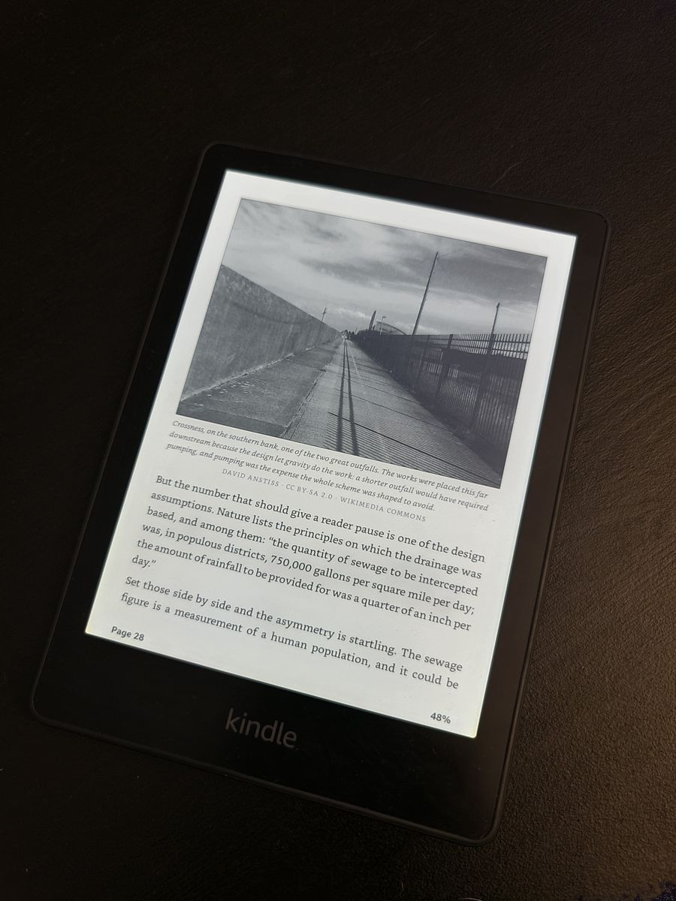
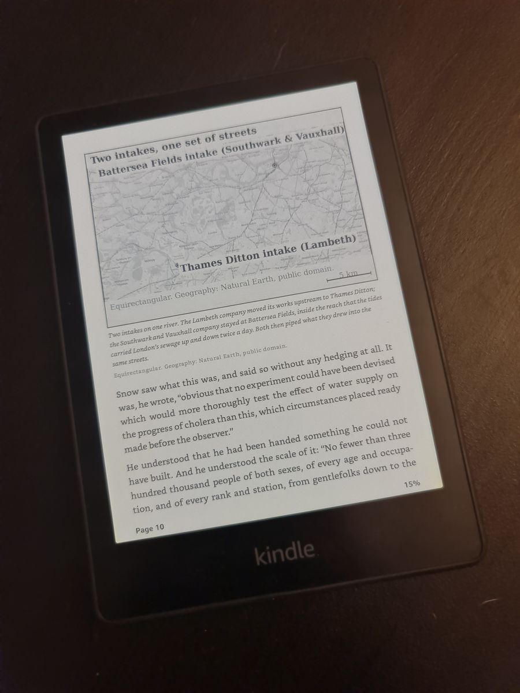
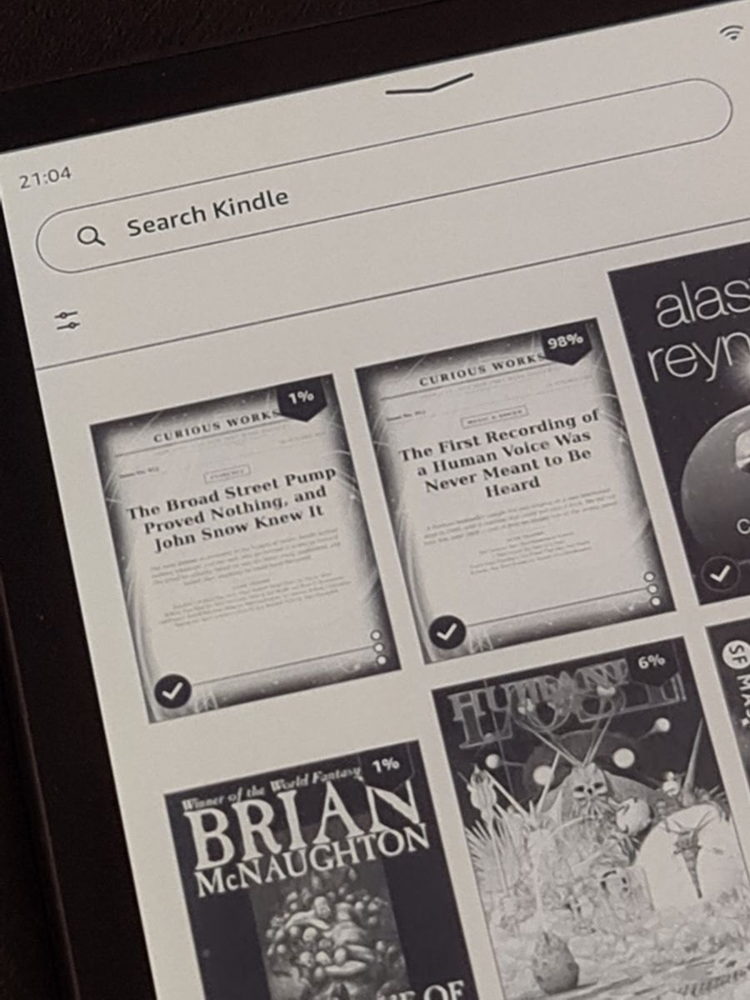

## What is this?
Like a lot of people, I used to start the morning by reaching for my phone and scrolling. I wanted to swap that habit for something calmer, so I tried to make a small morning magazine that is waiting on my Kindle instead.

The magazine is called **Curious Works**, with the subtitle *"Problems, and how they were solved"*. Each issue takes one interesting topic and tells it as a long-form story, with pictures, maps and a proper newspaper layout. Nobody writes it by hand. An AI agent running on my own setup researches it, puts it together and delivers it.

*Issue No. 011 (13 October 2026), a Music & Sound issue with an illustrated cover*

## How it works
At a high level:

- **Self-hosted Open WebUI.** Everything runs locally on my own Open WebUI setup, not in someone else's app.
- **A recursive research agent.** The bot takes an interesting topic and researches it in depth. It works recursively, so it digs into what it finds and follows the threads further instead of stopping at the first answer.
- **Images.** It creates images for the issue, such as the illustrated cover, and the inside pages also use sourced photos and maps.
- **Newspaper layout.** All of it is laid out like a printed magazine: masthead, issue number and date, section label, headline, standfirst and drop cap.
- **Wireless delivery.** The finished issue is sent wirelessly to my Kindle, where it shows up in the library like any other book.
- **It runs on its own.** Once it's set up, the whole thing works automatically. I don't have to start anything, I just pick up the Kindle.

## What the issues look like
Issue No. 012 is an Evidence issue: *"The Broad Street Pump Proved Nothing, and John Snow Knew It"*. Under the title it says plainly that it was written by AI from published sources. I think that kind of honesty matters if you're going to read AI-written text first thing in the morning.

*Issue No. 012 (Friday 16 October 2026): headline, standfirst, drop cap and the "Written by AI from published sources" line*

Inside, the pages mix text with real photos and maps. The photos come with their credits and licences, for example Wikimedia Commons images under CC BY-SA, and the maps are generated for the story.

*A sourced photo with its caption and licence credit (Wikimedia Commons, CC BY-SA)*

*A map generated for the John Snow story, with its own caption and source note*

And this is where they end up: in the Kindle library, next to the regular books.

*Issues No. 011 and No. 012 sitting in the Kindle library between regular books*

## Why I see it as an AI study
For me this is mainly an experiment in what an AI agent can do on its own, from start to finish, without me in the loop. It has to find a topic worth reading, research it deeply enough to tell a real story, make images, design the pages and get the result to a device. Every step is a small problem of its own, and the interesting part is seeing how well they hold together when nobody is watching.

It's also a test of whether AI can make something you actually want to spend time with, rather than more content to scroll past. A quiet, finished magazine on an e-ink screen is about as far from a feed as I could think of.

## Result
A working, fully automatic pipeline that turns my self-hosted AI setup into a small morning magazine. New issues of Curious Works show up on my Kindle without me doing anything, and the idea is simple: start the morning with a story instead of a phone.
