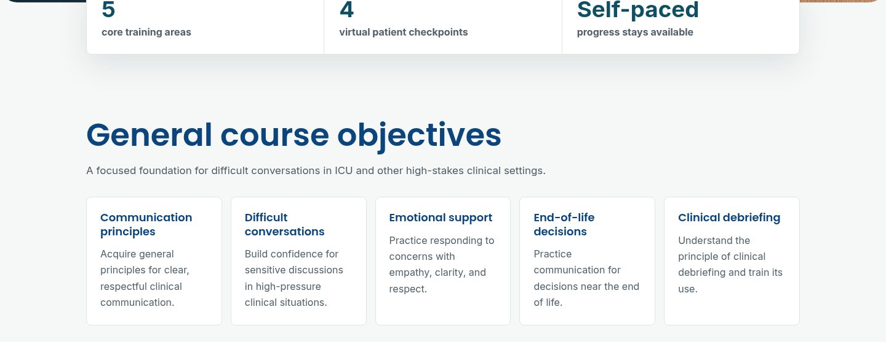
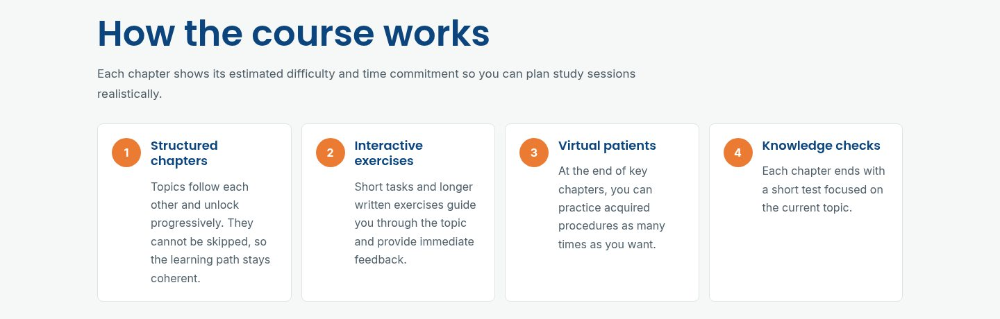

[VISIT THE LIVE COURSE](https://komunikace-icu.cz)

## What is this?
"Difficult communication in the ICU environment" is an online course for healthcare teams. It covers the conversations nobody really wants to have: delivering bad news (the SPIKES protocol), handling emotions (NURSE), end-of-life decision making, working with your own emotions, and clinical debriefing, including a VR scenario.

The course has 5 core training areas and 4 virtual patient checkpoints. It is self-paced and access doesn't expire. Each chapter is built the same way: short lessons, printable materials, a virtual patient, a test and a summary.

## My role
I was the sole product owner, and I did the whole development. I programmed the entire site, built the custom Moodle plugins and made the interactive virtual patients. So every decision about how something should work, and then actually making it work, landed on my desk.

## The problem
You can read about SPIKES all day, but the hard part is saying it out loud to someone who is upset. Stock Moodle is good at hosting lessons and quizzes, not at letting you practice a conversation. It also doesn't look or feel like a modern course out of the box, and it doesn't sell itself. So most of the job was bending Moodle into something it wasn't really made for, without breaking the parts it is good at.

## What I built

### Virtual patients
The core of the course. The trainee plays the doctor - for example delivering serious news to a patient's mother - and talks to the virtual patient through the microphone. The avatar is animated and lip-synced in real time, and the trainee's responses are evaluated by AI. The interface has a medical report to look at, a button to end the conversation, and a "Report a Bug" button.

This is built as two of my own activity modules: Conversation Avatar (the avatar and voice conversation) and AI Reply Box (the AI-evaluated replies).

### 14 custom Moodle plugins
Everything custom has the `cg` prefix:

- **Activity modules:** CG Accordion, AI Reply Box, CG content, Conversation Avatar, Course Completion Summary, CG Drag To Folder, CG Form, Hot-Cold Form, Microphone Test, CG Multiple Questions Slideshow Test, CG Spacer.
- **Course format:** a custom course format with branded gradient section headers, a collapsible nested chapter tree, previous/next navigation, locked sections and a sticky chapter progress bar. Section nesting, translations and progress are all settings, not hard-coded.
- **Local plugins:** CG Consent Manager and Student Tracking.

On top of those, I wrote my own local plugins for pages, a registration gate and a single-course storefront.

### Course experience
Chapters go one after another, with short lessons and tips, materials you can print, and a progress bar that stays visible while you read. The Microphone Test activity is there for a boring but very real reason: if the microphone doesn't work, the virtual patient doesn't either, so it's better to find out before the conversation starts. The whole site runs on the Universe theme and is bilingual (Czech and English).

### Storefront and payments
The course is sold directly on the site. A single-course storefront and a registration gate handle access, and payments go through Stripe.

## Result
The course is live at [komunikace-icu.cz](https://komunikace-icu.cz): a full Moodle-based product, from the landing page and payments all the way to practicing difficult conversations with an AI-evaluated virtual patient. Designed and built by me, as product owner and sole developer.
